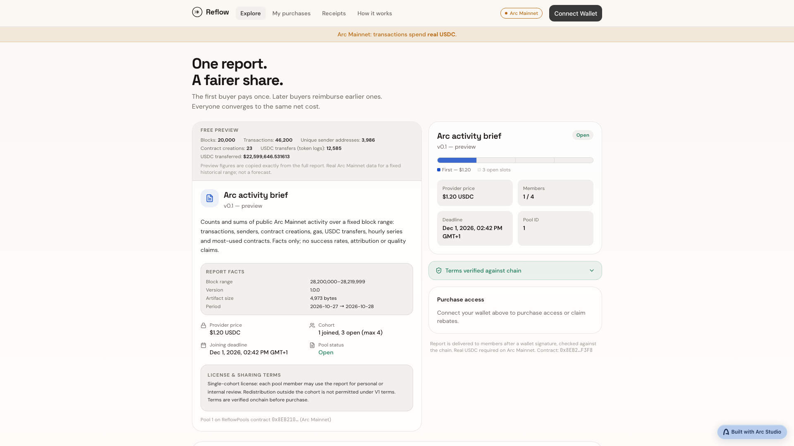
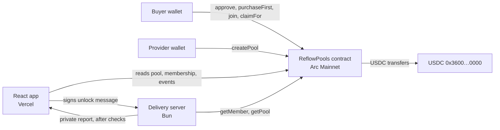
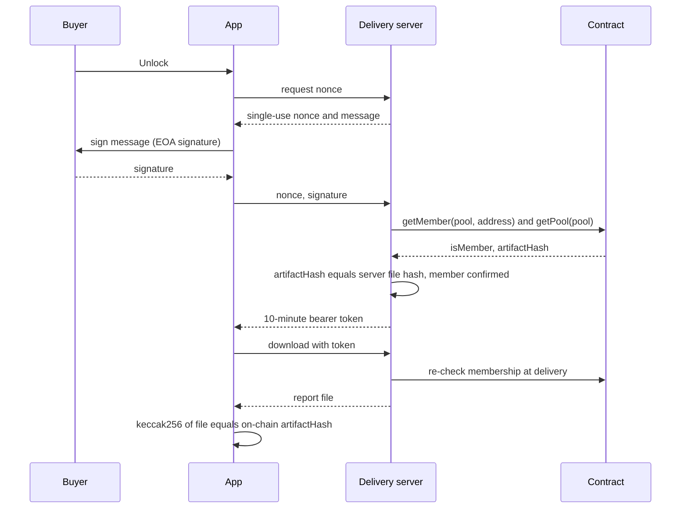

<p align="center">
  
</p>

# Reflow


### The first buyer pays once. Later buyers reimburse them. Everyone ends at the same net cost.

When a small group shares a report or dataset, one person usually pays the full price and then chases the others for their share. Reflow settles that on Arc in USDC with a contract that has no owner, no upgrade path and no admin sweep. The first buyer pays the provider the full price, each later buyer pays an equal share, and the difference flows back to earlier buyers as rebates they can claim. Every payment in the demo is real USDC on Arc Mainnet, not a mock.

**[Watch the demo](https://youtu.be/asWOEPYAo2Y)** · **[Live app](https://reflow-zeta.vercel.app)** · **[Verify it yourself](#verify-it-yourself-in-60-seconds)** · **[Architecture](ARCHITECTURE.md)** · **[Run it locally](#run-it-locally-deploy-tests)**

Built with [Arc Studio](https://studio.arc.io/app/29b3248b-8871-4fa5-81ec-96da70644dff) for the Arc Microgrants: Built with Arc Studio grant.

## Demo

[](https://youtu.be/asWOEPYAo2Y)

2 minutes. It shows the Studio build, the live app on Arc Mainnet, the deployed contract checked from outside the app, and the mainnet purchase transaction on explorer.arc.io. The video is assembled from real captures of the live app, the explorer and the verification script; nothing is sped up. The wallet signing itself is not shown on screen; the transaction on the explorer is the proof.

## Verify it yourself in 60 seconds

Contract on Arc Mainnet: [`0x8EB21094f6cEF274a2e4E31C86CA9027f3b5F3F8`](https://explorer.arc.io/address/0x8EB21094f6cEF274a2e4E31C86CA9027f3b5F3F8). You need [Foundry](https://getfoundry.sh) for `cast` and Python 3.

```sh
A=0x8EB21094f6cEF274a2e4E31C86CA9027f3b5F3F8
R=https://rpc.mainnet.arc.io

cast call $A 'usdc()(address)' --rpc-url $R
# 0x3600000000000000000000000000000000000000        (the canonical Arc USDC)

cast call $A 'nextPoolId()(uint256)' --rpc-url $R
# 2                                                  (pool 1 exists)

cast keccak 0x$(xxd -p public/report-mainnet-v1/terms.md | tr -d '\n')
# 0x2e30e6919339d57066255eb75123d45ede7d1651536e4dcdce848366896dd073   (equals pool 1's termsHash on chain)
```

Check that the deployed bytecode is exactly this repository's reviewed build, and that pool 1 holds the committed price, cap and hashes:

```sh
forge build
python3 tools/verify_deployment.py --rpc $R --chain-id 5042 --address $A --pool 1 \
  --artifact-hash 0x202799799200624d68ece590b67f68a62e4739382f8f72965ee577937d201b10 \
  --terms-hash    0x2e30e6919339d57066255eb75123d45ede7d1651536e4dcdce848366896dd073 \
  --price 1200000 --cap 4
# PASS chain id / PASS runtime code identical to local build / PASS usdc() is the canonical USDC /
# PASS pool exists / PASS price / PASS cap / PASS artifactHash / PASS termsHash
# RESULT: ALL CHECKS PASSED
```

| Fact | Where to check it |
|---|---|
| Contract deployed | [tx `0xb3c26593…a6eab`](https://explorer.arc.io/tx/0xb3c26593931e5a1dc37ae5a4de0c874bb5e244f64108508decbae4dfea4a6eab), block 28,894,881 |
| Pool 1 created (1.20 USDC, cap 4) | [tx `0xc2fd7685…7abd7`](https://explorer.arc.io/tx/0xc2fd768536a52647b53ae5feb17b5e3c58714d771295d4a9fa12004e1957abd7) |
| First purchase: 1.20 USDC buyer to provider through the contract | [tx `0xcccfa726…bfd320`](https://explorer.arc.io/tx/0xcccfa726b24fdefd09439a91fdf89539a514aa6e29e721426a5cc7529cbfd320) (USDC `Transfer` and the contract's membership event, same transaction) |
| Tests | `forge test` (86), `bun run test:client` (419), `bun run test:server` (171) |

## Contents

[The problem](#the-problem) · [What it does](#what-it-does) · [Architecture](#architecture) · [The hard problem](#the-hard-problem-the-server-that-read-the-wrong-word) · [Real vs simplified](#whats-real-vs-simplified) · [Engineering decisions](#engineering-decisions) · [Stack and layout](#tech-stack-and-project-layout) · [Run locally](#run-it-locally-deploy-tests) · [Limitations](#known-limitations-and-disclosure)

## The problem

A small team or cohort wants one report, dataset or tool licence. Today one person fronts the money and chases the others by hand, or everyone pays in full for the same thing. The cost of that is time and an awkward ledger, and the person who paid first carries the risk that others never reimburse them. This is a hypothesis from the builder's own experience; no user research or outside evidence backs it yet.

Arc is what makes the fix possible: USDC is both the payment token and the gas token, so a buyer needs exactly one asset, and sub-second finality lets the app show a confirmed receipt straight from the chain. Take the settlement contract away and the rebates are a promise; with it they are enforced by code.

## What it does

| Capability | What the user does | Exact calls behind it |
|---|---|---|
| Open a pool | Provider sets price, cap, deadline, and commits the report and terms hashes | `createPool(price, artifactHash, termsHash, deadline, cap)` |
| First purchase | First buyer pays the full price straight to the provider | USDC `approve`, then `purchaseFirst(poolId)` |
| Join | Later buyer pays an equal share of the total, with a slippage guard | `join(poolId, expectedCount, maxContribution)` |
| Claim rebates | Any member (or anyone, on their behalf) pulls credited rebates | `claimFor(poolId, member)` |
| Unlock the report | Member signs a message; the server checks membership and the file hash on chain, then delivers | `getMember`, `getPool`, then a short-lived token |
| Verify before paying | App shows terms hash verified against the chain before purchase | `getPool` plus a browser-side keccak256 of the public terms |

Share formula: a pool with `n` members and total contribution `C` gives member `i` an equal share `floor(C/n)` plus one extra micro-USDC for the first `C mod n` members, so net contributions are equal to within one micro-USDC.

## Architecture



The key flow, unlocking the report you paid for:



| Part | Role |
|---|---|
| `contracts/ReflowPools.sol` | Settlement: pools, equal-share formula, rebate accounting, claims. Immutable `usdc`, requires token `decimals()` of 6, no owner or upgrade |
| `src/lib/TxOrchestrator.ts` | Transaction safety: synchronous latch, signing intent persisted before the wallet call, allowance-first, mandatory gas estimates, boot-time lock for unfinished records |
| `src/lib/network.ts` | One guarded network setting; refuses testnet contracts and report hashes on mainnet |
| `server/core/delivery.ts` | Delivery logic: single-use nonce, byte-identical message, signature, on-chain membership, hash binding, rate limits |

More detail is in [ARCHITECTURE.md](ARCHITECTURE.md).

## The hard problem: the server that read the wrong word

The delivery server decides whether a wallet may download the report by calling the contract's `getMember(poolId, address)`. That function returns a struct of five fields: `joinOrder`, `grossPaid`, `rebatesAllocated`, `rebatesClaimed`, `isMember`, with `isMember` last. The first server build decoded the raw return data by position and read the first word, `joinOrder`, as if it were `isMember`.

Its unit tests passed, because they fed it hand-written values. The bug only showed up when the server's exact reads were run against the live contract: membership was being decided from the wrong field. A check that "passes" while reading the wrong word is worse than no check, because it looks like access control.

What we did instead: the server decodes the struct by field name from the contract's ABI, and tests run the decoder against real encoded return data, including a member with `joinOrder` 0 and one with `joinOrder` 2, both `isMember` true. The server also compares the on-chain `artifactHash` to the hash of the file it is about to send, and re-checks membership at delivery time, not only when the token is issued. See `server/chainAdapter.ts` and `server/tests/chainAdapter.test.ts`.

A second one, found while hosting: a production build resolved Arc Testnet whatever the configuration said, because the network was read through a runtime `'env' in import.meta` check that is only true in the dev server. The hosted site showed testnet against a mainnet contract. It is fixed, and `server/tests/viteBuild.test.ts` now runs a real `vite build` and asserts the result. More of these are in [docs/build-log.md](docs/build-log.md).

## What's real vs simplified

| Capability | How it is backed | Status |
|---|---|---|
| Settlement contract | Deployed on Arc Mainnet, bytecode verified against this repo's build | Real |
| Pool creation and first purchase | Mainnet transactions linked above, real USDC | Real |
| Join and rebate claim | Exercised end to end on Arc Testnet (test pool and report pool); covered by 86 contract tests. Not yet run on Arc Mainnet | Real on testnet; not run on mainnet |
| Report delivery (unlock) | Signature, on-chain membership and hash checks, verified live on Arc Testnet. The hosted link has no delivery server, so unlock is not available there | Real locally; not hosted |
| Report content | Counts and sums of public Arc Mainnet activity for blocks 28,200,000 to 28,219,999, reproducible with `report/generate_report_v2.py`. The data is public; the product is a hash-committed copy and the cost-sharing | Real data |
| Docker image and Fly.io config | Files are in the repo but have not been built or deployed | Not built |
| Contract audit | None | Not built |
| Smart-contract wallets for unlock | Delivery accepts externally owned account signatures only | Not built |
| Multi-instance delivery server | Nonce store is in memory, single instance | Simplified |

## Engineering decisions

- **No owner, no admin, no upgrade.** The contract holds no funds beyond owed rebates and has no sweep, so a provider or the builder cannot take buyers' money. Cost: no way to fix a bug in place.
- **Provider cannot buy or join their own pool.** Prevents wash-trading rebates. This is also why a mainnet demo needs two wallets.
- **Equal-share rounding is deterministic.** `floor(C/n)` plus one micro-USDC for the first `C mod n` members; fuzz-tested so shares always sum to `C`.
- **Allowance first, intent persisted before signing.** A refresh or a crash between approval and purchase cannot leave the app guessing; unfinished records lock the UI until reconciled.
- **Network is one guarded setting.** Mainnet refuses the known testnet contract and the testnet report hashes; the build and the server both fail on conflicting settings.
- **Delivery binds to the file, not to a promise.** The pool commits `artifactHash`; the server refuses to serve a file whose hash differs.
- **Arc sharp edges:** USDC is 18 decimals as the native gas token but 6 as ERC-20, and one balance backs both. The contract reads decimals and requires 6. A local Anvil fork of Arc cannot do USDC transfers, so contract behaviour was verified on the real testnet, not a fork. Public RPCs rate-limit and prune old logs.

## Tech stack and project layout

Solidity 0.8.28, Foundry, OpenZeppelin 5.1 · React 18, Vite, Tailwind, viem · Bun delivery server · Arc Mainnet and USDC · hosted on Vercel.

```
contracts/ReflowPools.sol     the settlement contract; tests in contracts/test
src/                          React app (src/lib: transaction safety, network guard, delivery client)
src/tests/                    client tests (419)
server/                       delivery service: core logic, chain adapter, static serving, config validation
server/tests/                 server tests (171)
public/report-mainnet-v1/     public manifest, preview and license terms for the mainnet report
public/report-v1, test-pool/  testnet report and the labelled test pool
report/                       open generator for the report data (written outside Studio)
tools/verify_deployment.py    read-only check that a deployed address runs this build
docs/                         build log, evidence, demo script, submission text, hosting notes
Dockerfile, fly.toml          hosting files (not built or deployed)
```

## Run it locally, deploy, tests

Prerequisites: [Bun](https://bun.sh), [Foundry](https://getfoundry.sh), Python 3.

```sh
bun install
cp .env.example .env     # then edit
bun run dev              # app on http://localhost:5173
bun run server           # delivery server (needs the private report file, see below)
```

| Variable | Required | Description |
|---|---|---|
| `VITE_REFLOW_NETWORK` | No | `testnet` (default) or `mainnet` |
| `VITE_REFLOW_CONTRACT` | Yes | `ReflowPools` address; mainnet: `0x8EB21094f6cEF274a2e4E31C86CA9027f3b5F3F8` |
| `VITE_REFLOW_POOL_ID` | Yes | Pool the app shows; mainnet report pool is `1` |
| `VITE_REFLOW_FROM_BLOCK` | No | Block to start reading events from; mainnet: `28894881` |
| `REFLOW_POOL_ID` | Server | Pool the server delivers for |
| `HMAC_SECRET` | Server | 32-byte hex token signing key; random per start if unset |
| `PUBLIC_ORIGIN`, `DOMAIN` | Server | Origin and host used in the signed unlock message |

The paid report file is private and is not in this repository. To exercise delivery, generate it with `python3 report/generate_report_v2.py --chain-id 5042 --network-name "Arc Mainnet" --from-block 28200000 --to-block 28219999 --out server/private/arc-activity-report-mainnet-v1.json` and place it in `server/private/` (git-ignored); the file's keccak256 must equal the pool's on-chain `artifactHash`.

```sh
forge test                 # 86 contract tests
bun run typecheck && bun run typecheck:server
bun run test:client        # 419
bun run test:server        # 171
bun run build              # production build
```

Three test files (`src/tests/deliveryClient.test.ts`, `src/tests/m3b.test.ts`, `server/tests/delivery.test.ts`) read the private report from `server/private/`; without it they fail with a missing-file error and everything else passes.

## Known limitations and disclosure

- Unaudited code that handles real USDC. Use small amounts.
- The delivery server is single-instance and in-memory, accepts EOA signatures only, and is not hosted behind the public link.
- USDC itself can be paused or blocklisted by its issuer; Reflow is independent of Circle and Arc.
- The problem statement is a hypothesis; there has been no user research.
- Built for the Arc Microgrants: Built with Arc Studio grant (submission deadline 1 November 2026, UTC+1). First commit 18 October 2026. The app, contract and server were written in Arc Studio; each export was independently re-tested before being used. The README, `tools/verify_deployment.py` and `report/` were written outside Studio. No template was used.
- Not financial advice.
